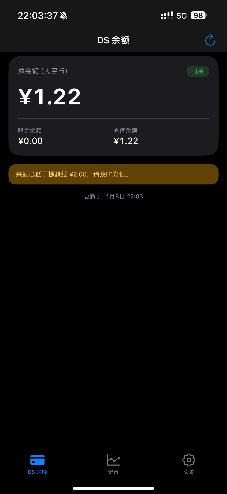
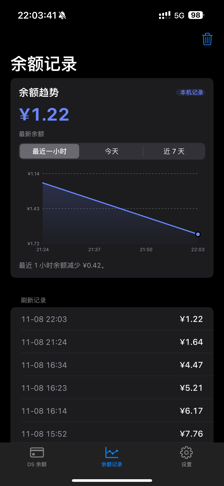
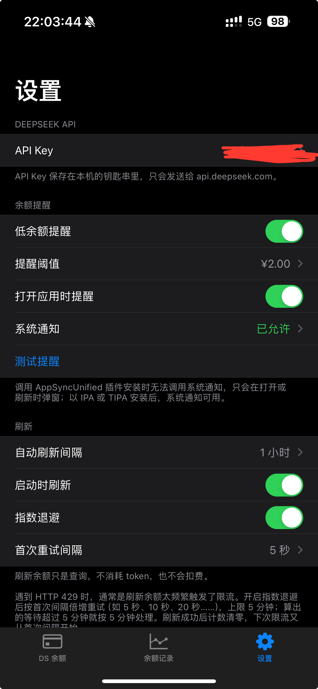

# DS 余额

一个查看 DeepSeek 开放平台余额的 iOS 应用，原生 Objective-C / UIKit 编写，支持深浅色、余额变化记录与低余额提醒。

## 截图

| 余额 | 记录 | 设置 |
| --- | --- | --- |
|  |  |  |

## 功能

- 调用官方 `GET /user/balance`，显示总余额、赠金余额、充值余额与账户可用状态
- 记录每次刷新时的余额，按「最近一小时 / 今天 / 近 7 天」统计消耗
- 低余额提醒：阈值可设，刷新时弹窗；以侧载方式安装时可用系统通知
- 自动刷新：前台按设定间隔刷新，进入后台后向系统申请后台检查
- 遇到 HTTP 429 时提示限流，并可选择指数退避自动重试（默认 5 秒起，逐次翻倍，上限 5 分钟）
- 跟随系统 / 浅色 / 深色三档外观
- API Key 保存在本机钥匙串，并在偏好设置里留一份副本，防止重签后读不到

## 已知限制

- DeepSeek 开放平台没有公开的用量明细接口，记录页的数据全部来自本机采样，不是官方账单。
- 安装在 `/Applications` 的越狱版拿不到系统通知权限；只有以 IPA / TIPA 安装的系统才允许。
- App 被从多任务界面划掉后不会继续检测；后台检查由 iOS 调度，不保证执行时刻。
- 余额查询是只读接口，不消耗 token，也不产生费用。

## 构建

### 命令行（不依赖 Apelin）

```sh
SDKROOT=/path/to/iPhoneOS17.2.sdk sh build.sh
```

在 iOS 设备本身上构建时也用它——越狱环境通常没有 `/bin/sh`，直接 `./build.sh` 会报找不到文件。

需要 `clang`（Xcode Command Line Tools）与一份 iPhoneOS SDK；`zip` 用于打包；签名可选——macOS 上是 `codesign`，其他系统是 `ldid`，两者都没有时产出的包只有 TrollStore 能装。

产物：

- `build/DSBalance.ipa`
- `build/DSBalance.tipa`

只编译单一架构可设 `ARCHS=arm64`。

### 用 Apelin

`apelin-project.json` 是 Apelin 的构建描述：产品、源文件、框架、资源、包信息与构建步骤都在里面。在 Apelin 中打开本目录构建即可，产物是 `.deb`，适合越狱安装。

部署目标 iOS 16.0。

## 预编译安装包

`release/` 下是本版本的侧载包：

- `DSBalance.ipa` —— AltStore、Sideloadly 等工具安装，安装时会用你的证书重签
- `DSBalance.tipa` —— TrollStore 直接安装

两者内容相同，区别只在 `.tipa` 里多一个空的 `_TrollStore` 标记文件。安装后是用户应用，系统通知可用；用 AppSyncUnified 之类的插件装进 `/Applications` 则拿不到通知权限。

## 目录结构

```
Sources/            Objective-C 源码
Resources/          Info.plist 与图标
Packaging/          App.entitlements
docs/screenshots/   README 截图
release/            预编译的 IPA / TIPA
build.sh            命令行构建脚本
apelin-project.json Apelin 构建描述
```

## 许可

代码以 MIT 许可发布，见 `LICENSE`。应用图标的图片素材版权归其作者所有。
